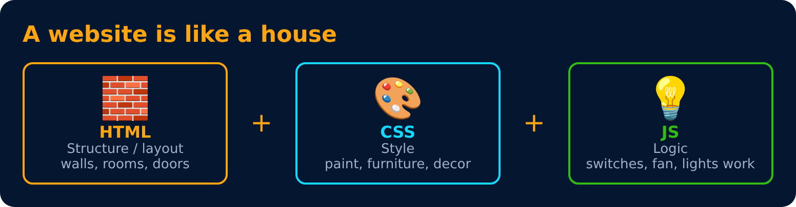

# CSS Notes

| HTML | CSS | JS |
|:---:|:---:|:---:|
| Structure / layout | Style | Logic |

> One file per slide, same order as the PDF. Most slides have a picture of **what the CSS does in the browser** or a diagram.
> Practice sets have a hidden 💡 Solution. Try first, then open it. Use ← / → links at the bottom of each file to move around.

## Contents

### [Level 1 : Basics of CSS](level-1/README.md) 🟩⬜⬜⬜⬜

Syntax, adding CSS, colors, selectors, specificity and text properties.

- [CSS](level-1/03-css.md)
- [Basic Syntax](level-1/04-basic-syntax.md)
- [Including Style](level-1/05-including-style.md)
- [Including Style (External)](level-1/06-including-style-external.md)
- [Color Property](level-1/07-color-property.md)
- [Background Color Property](level-1/08-background-color-property.md)
- [Color Systems : RGB](level-1/09-color-systems-rgb.md)
- [Color Systems : Hex](level-1/10-color-systems-hex.md)
- [Selectors](level-1/11-selectors.md)
- [Combinator Selectors](level-1/12-combinator-selectors.md)
- [Pseudo-classes](level-1/13-pseudo-classes.md)
- [Pseudo-elements](level-1/14-pseudo-elements.md)
- [Specificity](level-1/15-specificity.md)
- [Practice Set 1 🚀](level-1/16-practice-set-1.md)
- [Text Properties : text-align](level-1/17-text-properties-text-align.md)
- [Text Properties : text-decoration](level-1/18-text-properties-text-decoration.md)
- [Text Properties : font-weight](level-1/19-text-properties-font-weight.md)
- [Text Properties : font-family](level-1/20-text-properties-font-family.md)
- [Font Families](level-1/21-font-families.md)
- [Units in CSS : Absolute](level-1/22-units-in-css-absolute.md)
- [Text Properties : line-height](level-1/23-text-properties-line-height.md)
- [Text Properties : text-transform](level-1/24-text-properties-text-transform.md)
- [Text Properties : more](level-1/25-text-properties-more.md)
- [Practice Set 2 🚀](level-1/26-practice-set-2.md)

### [Level 2 : Box Model in CSS](level-2/README.md) 🟩🟩⬜⬜⬜

Height, width, border, padding, margin, box-sizing, display, visibility and opacity.

- [Box Model in CSS](level-2/28-box-model-in-css.md)
- [Height](level-2/29-height.md)
- [Width](level-2/30-width.md)
- [Border](level-2/31-border.md)
- [Border : Shorthand](level-2/32-border-shorthand.md)
- [Border : border-radius](level-2/33-border-border-radius.md)
- [Padding](level-2/34-padding.md)
- [Padding : Shorthand](level-2/35-padding-shorthand.md)
- [Margin](level-2/36-margin.md)
- [Margin : Shorthand](level-2/37-margin-shorthand.md)
- [Box Sizing](level-2/38-box-sizing.md)
- [Overflow](level-2/39-overflow.md)
- [Min & Max Width](level-2/40-min-and-max-width.md)
- [Practice Set 3 🚀](level-2/41-practice-set-3.md)
- [Display Property](level-2/43-display-property.md)
- [Visibility](level-2/44-visibility.md)
- [Alpha Channel](level-2/45-alpha-channel.md)
- [Practice Set 4 🚀](level-2/46-practice-set-4.md)

### [Level 3 : Units, Position & Backgrounds](level-3/README.md) 🟩🟩🟩⬜⬜

Relative units, position, z-index, background images and shadows.

- [Units in CSS : Relative](level-3/48-units-in-css-relative.md)
- [Percentage (%)](level-3/49-percentage-percent.md)
- [Em](level-3/50-em.md)
- [Rem (Root Em)](level-3/51-rem-root-em.md)
- [Others](level-3/52-others.md)
- [Position](level-3/53-position.md)
- [Position : values](level-3/54-position-values.md)
- [z-index](level-3/55-z-index.md)
- [Background Image](level-3/56-background-image.md)
- [Background Size](level-3/57-background-size.md)
- [Background : more](level-3/58-background-more.md)
- [Shadows](level-3/59-shadows.md)
- [Practice Set 5 🚀](level-3/60-practice-set-5.md)

### [Level 4 : Flexbox, Grid & Media Queries](level-4/README.md) 🟩🟩🟩🟩⬜

Layouts in 1D and 2D, and making them responsive.

- [Flexbox](level-4/62-flexbox.md)
- [The Flex Model](level-4/63-the-flex-model.md)
- [Flexbox Direction](level-4/64-flexbox-direction.md)
- [Flex Properties : for Flex Container](level-4/65-flex-properties-for-flex-container.md)
- [Flex Properties : for Flex Item](level-4/66-flex-properties-for-flex-item.md)
- [Flex Properties : Shorthand & spacing](level-4/67-flex-properties-shorthand-and-spacing.md)
- [CSS Grid](level-4/68-css-grid.md)
- [Grid Item](level-4/69-grid-item.md)
- [Practice Set 6 🚀](level-4/70-practice-set-6.md)
- [Media Queries](level-4/71-media-queries.md)
- [Media Queries : range](level-4/72-media-queries-range.md)
- [Practice Set 7 🚀](level-4/73-practice-set-7.md)

### [Level 5 : Advanced CSS](level-5/README.md) 🟩🟩🟩🟩🟩

Transitions, transforms, animations and CSS variables.

- [Transitions](level-5/75-transitions.md)
- [Transition Shorthand](level-5/76-transition-shorthand.md)
- [CSS Transform : rotate](level-5/77-css-transform-rotate.md)
- [CSS Transform : scale](level-5/78-css-transform-scale.md)
- [CSS Transform : translate](level-5/79-css-transform-translate.md)
- [CSS Transform : skew](level-5/80-css-transform-skew.md)
- [Animation](level-5/81-animation.md)
- [Animation Properties](level-5/82-animation-properties.md)
- [Animation Shorthand](level-5/83-animation-shorthand.md)
- [% in Animation](level-5/84-percent-in-animation.md)
- [CSS Variables](level-5/85-css-variables.md)
- [Useful Properties](level-5/86-useful-properties.md)
- [Practice Set 8 🚀](level-5/87-practice-set-8.md)
