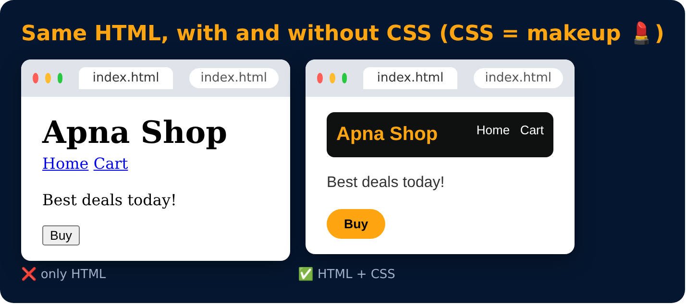

# CSS

**C**ascading **S**tyle **S**heet

It is a language that is used to describe the **style** of a document.

- CSS is not a programming language, it's a **styling** language (makeup 💄 for the page).
- To style something, we need content first. That's why we studied HTML before CSS.

---
[Level 1](README.md) · [Home](../README.md) · [Basic Syntax →](04-basic-syntax.md)
