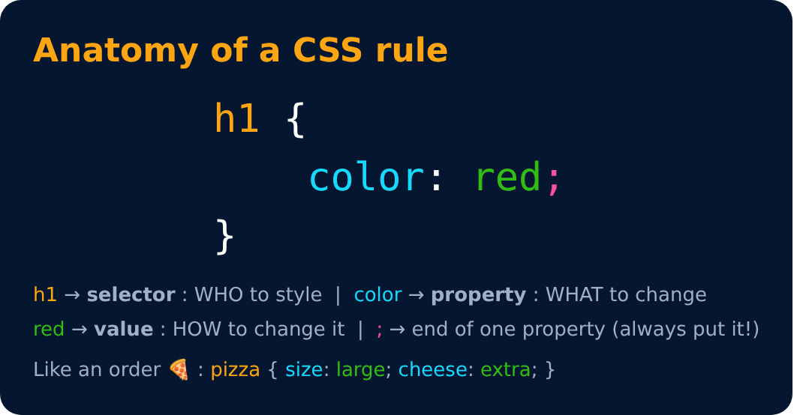

# Basic Syntax

<sub>Level 1 · Slide 4</sub>

```css
h1 {
    color: red;
}
```

- `h1` → **Selector**
- `color` → **Property**
- `red` → **Value**

> The semicolon `;` shows that one property has ended. Always put it, even though missing it on the last line won't give an error.



---
[← CSS](03-css.md) · [Level 1](README.md) · [Home](../README.md) · [Including Style →](05-including-style.md)
