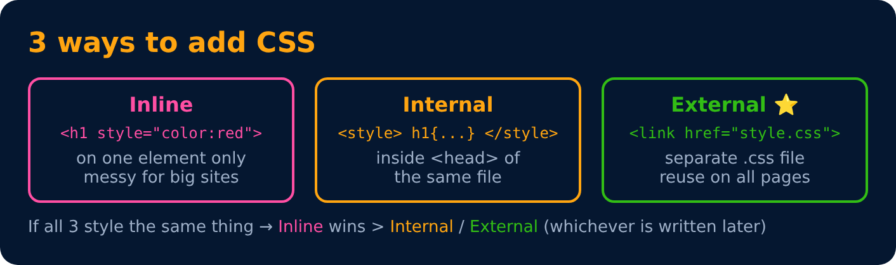

# Including Style

**Inline** : writing style directly inline on each element

```html
<h1 style="color: red"> Apna College </h1>
```

**`<style>` tag** : style is added using the `<style>` element in the same document

```html
<style>
    h1 {
        color: red;
    }
</style>
```



---
[← Basic Syntax](04-basic-syntax.md) · [Level 1](README.md) · [Home](../README.md) · [Including Style (External) →](06-including-style-external.md)
