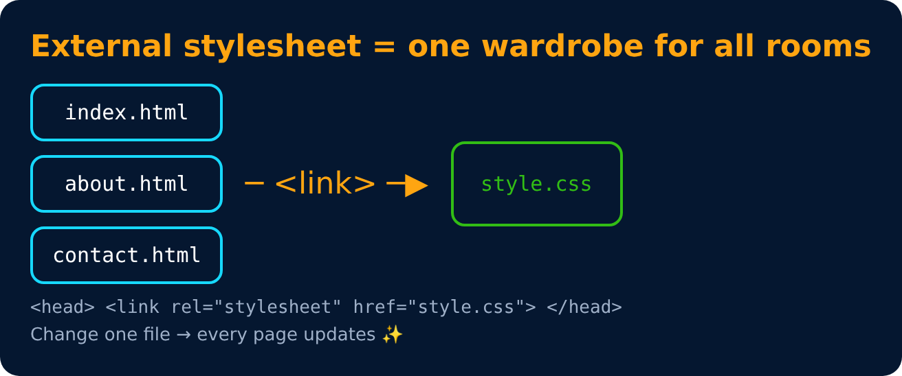

# Including Style (External)

**External Stylesheet** ⭐ (best way)

Writing CSS in a separate document & linking it with the HTML file

```html
<link rel="stylesheet" href="style.css">
```

> An inline style will override external and internal styles.



---
[← Including Style](05-including-style.md) · [Level 1](README.md) · [Home](../README.md) · [Color Property →](07-color-property.md)
