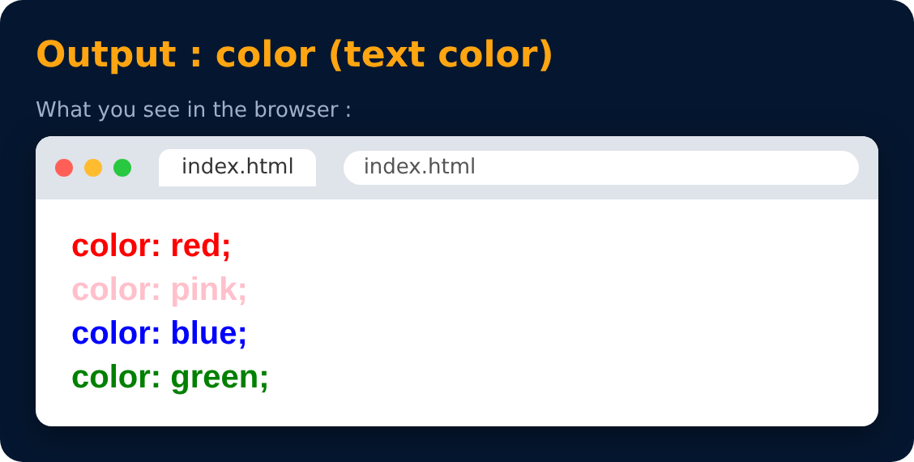

# Color Property

<sub>Level 1 · Slide 7</sub>

Used to set the color of **foreground** (text)

```css
color: red;
color: pink;
color: blue;
color: green;
```



---
[← Including Style (External)](06-including-style-external.md) · [Level 1](README.md) · [Home](../README.md) · [Background Color Property →](08-background-color-property.md)
