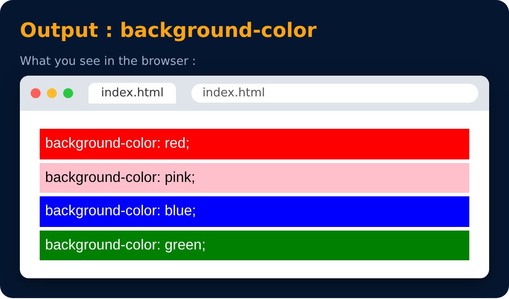

# Background Color Property

<sub>Level 1 · Slide 8</sub>

Used to set the color of **background**

```css
background-color: red;
background-color: pink;
background-color: blue;
background-color: green;
```



---
[← Color Property](07-color-property.md) · [Level 1](README.md) · [Home](../README.md) · [Color Systems : RGB →](09-color-systems-rgb.md)
