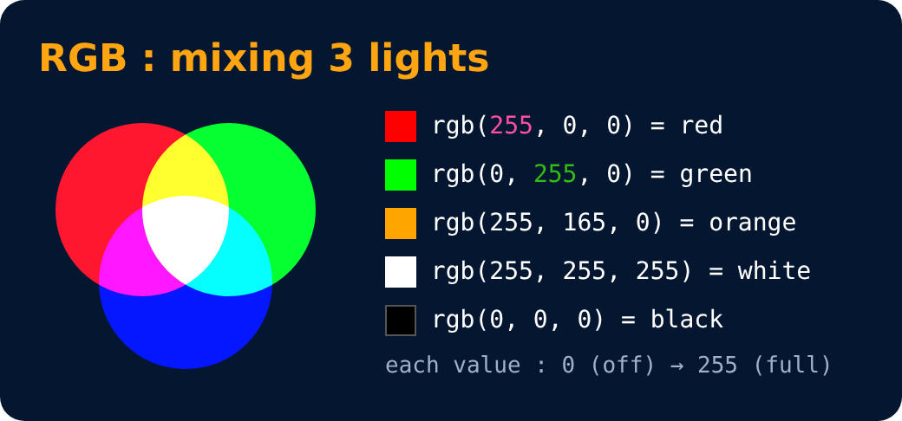

# Color Systems : RGB

<sub>Level 1 · Slide 9</sub>

**RGB**

```css
color: rgb(255, 0, 0);
color: rgb(0, 255, 0);
```

> We don't have to think of colors on our own. We can use color picker tools online.



---
[← Background Color Property](08-background-color-property.md) · [Level 1](README.md) · [Home](../README.md) · [Color Systems : Hex →](10-color-systems-hex.md)
