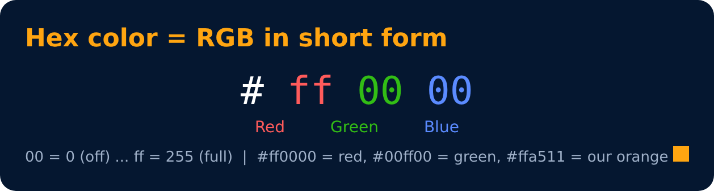

# Color Systems : Hex

<sub>Level 1 · Slide 10</sub>

**Hex (Hexadecimal)**

```css
color: #ff0000;
color: #00ff00;
```

> Search **"google color picker"** to get any color's hex & rgb value.



---
[← Color Systems : RGB](09-color-systems-rgb.md) · [Level 1](README.md) · [Home](../README.md) · [Selectors →](11-selectors.md)
