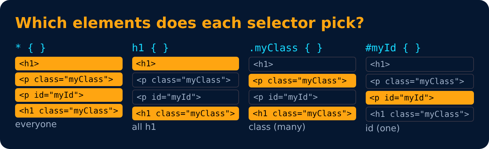

# Selectors

| Selector | Syntax |
|---|---|
| Universal Selector | `* { }` |
| Element Selector | `h1 { }` |
| Id Selector | `#myId { }` |
| Class Selector | `.myClass { }` |

---
[← Color Systems : Hex](10-color-systems-hex.md) · [Level 1](README.md) · [Home](../README.md) · [Combinator Selectors →](12-combinator-selectors.md)
