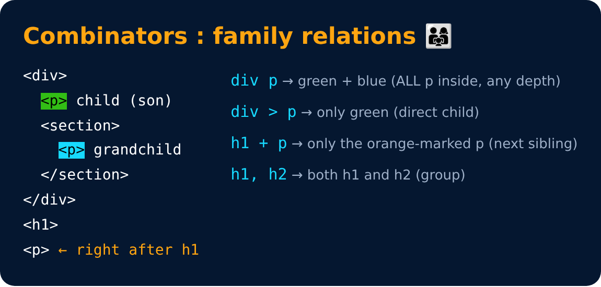

# Combinator Selectors

Select elements based on how they are related

| Selector | Meaning |
|---|---|
| `div p { }` | descendant - all p inside the div |
| `div > p { }` | child - only direct p children of div |
| `h1 + p { }` | adjacent - the p right after h1 |
| `h1, h2 { }` | group - same style for h1 & h2 |

---
[← Selectors](11-selectors.md) · [Level 1](README.md) · [Home](../README.md) · [Pseudo-classes →](13-pseudo-classes.md)
