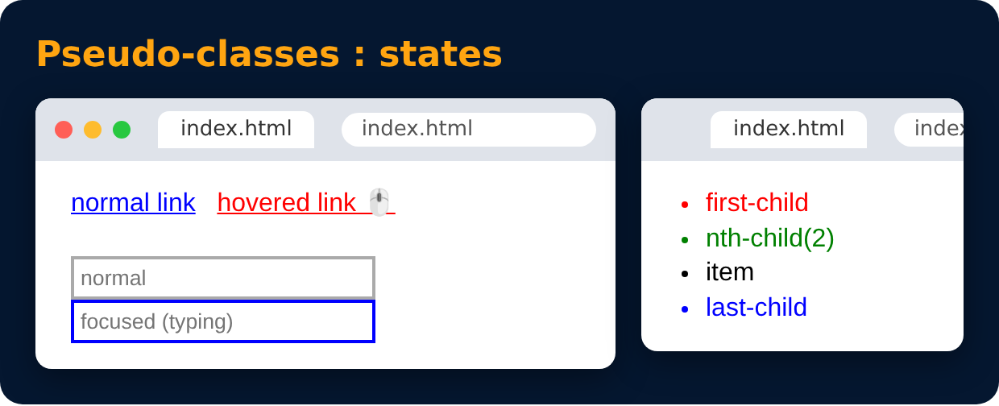

# Pseudo-classes

<sub>Level 1 · Slide 13</sub>

Style an element in a special state

```css
a:hover { color : red; }
input:focus { border-color : blue; }
li:first-child { }
li:last-child { }
li:nth-child(2) { }
a:visited { }
```

**hover** = mouse is over it, **focus** = clicked / typing in it



---
[← Combinator Selectors](12-combinator-selectors.md) · [Level 1](README.md) · [Home](../README.md) · [Pseudo-elements →](14-pseudo-elements.md)
