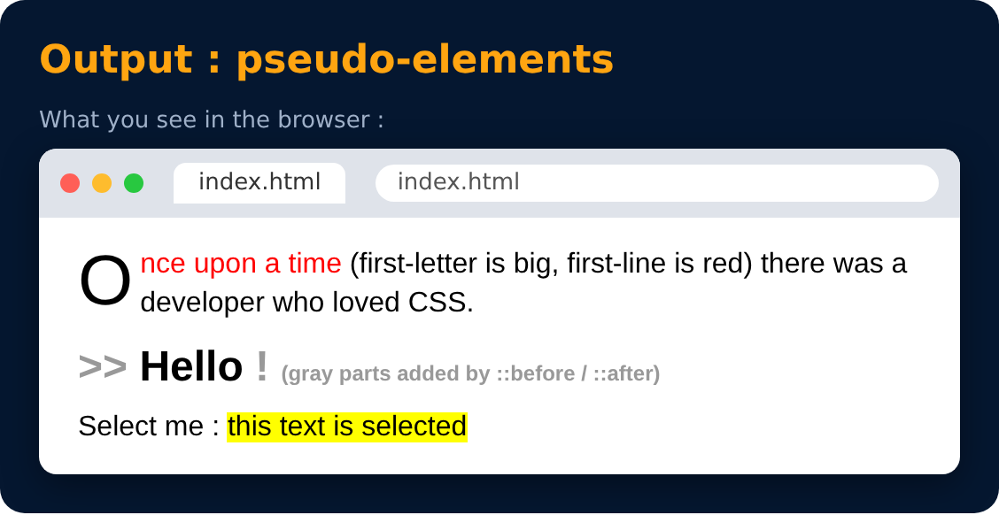

# Pseudo-elements

Style a specific part of an element

```css
p::first-letter { font-size : 40px; }
p::first-line { color : red; }
h1::before { content : ">> "; }
h1::after { content : " !"; }
::selection { background-color : yellow; }
```

> **Note :** pseudo-classes use one colon ( `:` ), pseudo-elements use two ( `::` )



---
[← Pseudo-classes](13-pseudo-classes.md) · [Level 1](README.md) · [Home](../README.md) · [Specificity →](15-specificity.md)
