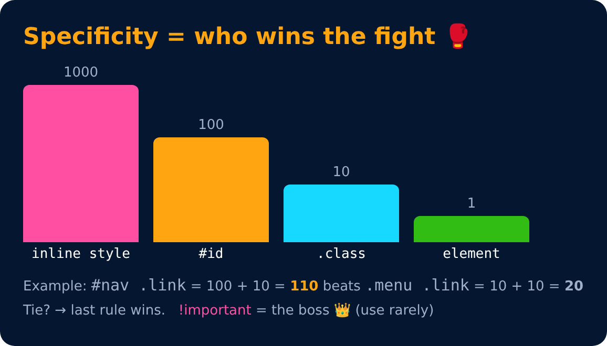

# Specificity

<sub>Level 1 · Slide 15</sub>

Decides which style wins when two rules target the same element

```
inline style  >  #id  >  .class  >  element
   1000          100       10         1
```

- Same specificity → the rule written last wins
- `!important` beats everything (use very rarely)
- `#nav .link` = 100 + 10 = 110 points



---
[← Pseudo-elements](14-pseudo-elements.md) · [Level 1](README.md) · [Home](../README.md) · [Practice Set 1 🚀 →](16-practice-set-1.md)
