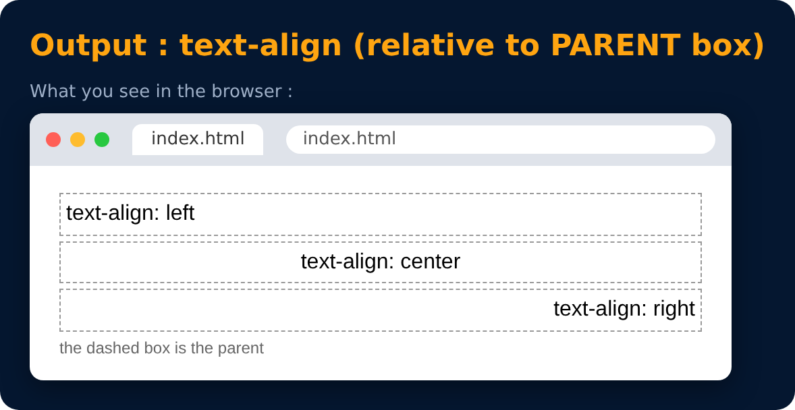

# Text Properties : text-align

<sub>Level 1 · Slide 17</sub>

```css
text-align : left / right / center
```

> Text alignment is not according to the page. `right` does not mean the page's right side, it means the **parent's** right side.
>
> In CSS3, `start` and `end` were added for languages written right-to-left, like Arabic.



---
[← Practice Set 1 🚀](16-practice-set-1.md) · [Level 1](README.md) · [Home](../README.md) · [Text Properties : text-decoration →](18-text-properties-text-decoration.md)
