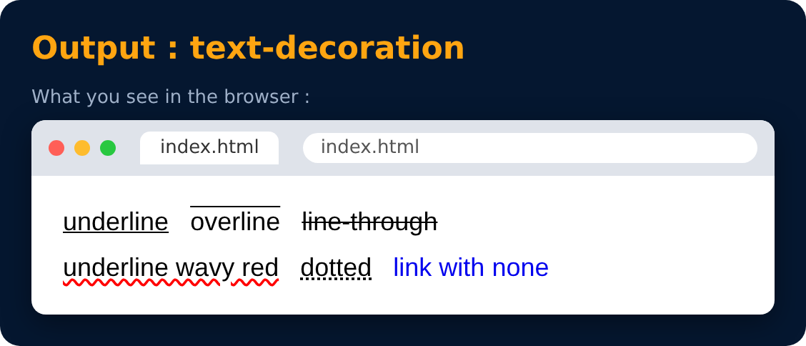

# Text Properties : text-decoration

<sub>Level 1 · Slide 18</sub>

```css
text-decoration : underline / overline / line-through
```

> You can also add a style (wavy, dotted) or a color like red. Set it to `none` to remove the underline from links.



---
[← Text Properties : text-align](17-text-properties-text-align.md) · [Level 1](README.md) · [Home](../README.md) · [Text Properties : font-weight →](19-text-properties-font-weight.md)
