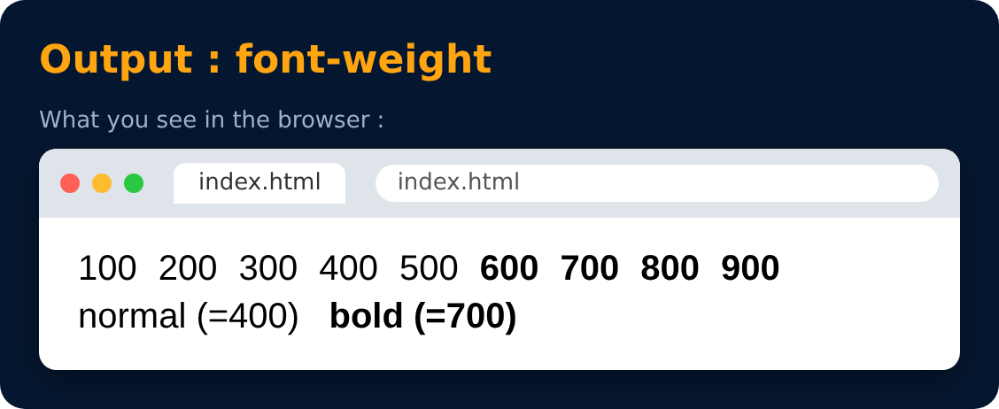

# Text Properties : font-weight

<sub>Level 1 · Slide 19</sub>

```css
font-weight : normal / bold / bolder / lighter
font-weight : 100-900
```

> font-weight shows how dark or light our text is. It can be names or numbers from 100 to 900.



---
[← Text Properties : text-decoration](18-text-properties-text-decoration.md) · [Level 1](README.md) · [Home](../README.md) · [Text Properties : font-family →](20-text-properties-font-family.md)
