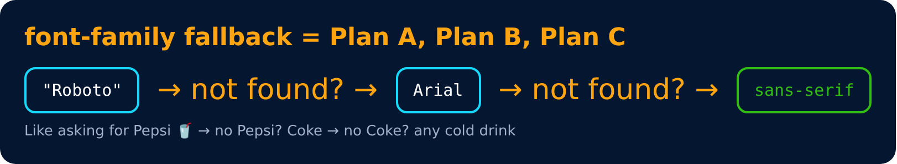

# Text Properties : font-family

```css
font-family : arial
font-family : arial, roboto
```

> We can write multiple families as a **fall-back** mechanism.



---
[← Text Properties : font-weight](19-text-properties-font-weight.md) · [Level 1](README.md) · [Home](../README.md) · [Font Families →](21-font-families.md)
