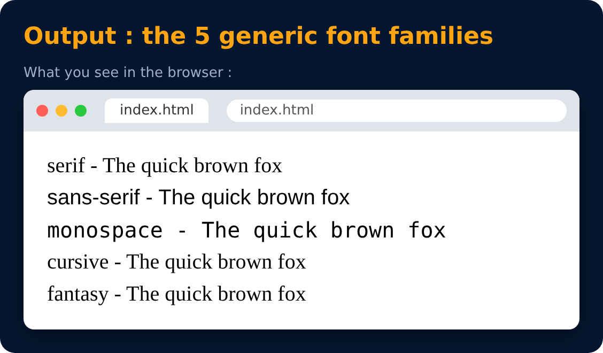

# Font Families

<sub>Level 1 · Slide 21</sub>

5 generic font families (browser picks a font of that type)

- **serif** - letters have small strokes at the ends (Times New Roman)
- **sans-serif** - clean letters, no strokes (Arial, Verdana)
- **monospace** - every letter takes the same width (Courier)
- **cursive** - handwriting style (Comic Sans)
- **fantasy** - decorative fonts

```css
font-family : "Times New Roman", serif;
```

> **Note :** the last one is the fallback, used if the first font is not available.



---
[← Text Properties : font-family](20-text-properties-font-family.md) · [Level 1](README.md) · [Home](../README.md) · [Units in CSS : Absolute →](22-units-in-css-absolute.md)
