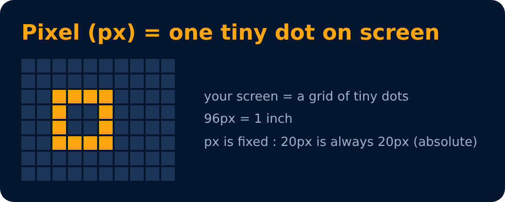

# Units in CSS : Absolute

**pixels (px)**

```
96px = 1 inch
```

```css
font-size: 2px;
```

> cm, mm, inch & others are also there, but pixels is the most used.



---
[← Font Families](21-font-families.md) · [Level 1](README.md) · [Home](../README.md) · [Text Properties : line-height →](23-text-properties-line-height.md)
