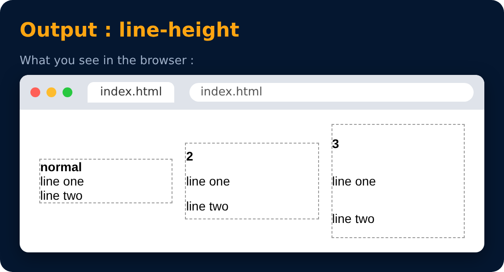

# Text Properties : line-height

<sub>Level 1 · Slide 23</sub>

```css
line-height : 2px
line-height : 3
line-height : normal
```



---
[← Units in CSS : Absolute](22-units-in-css-absolute.md) · [Level 1](README.md) · [Home](../README.md) · [Text Properties : text-transform →](24-text-properties-text-transform.md)
