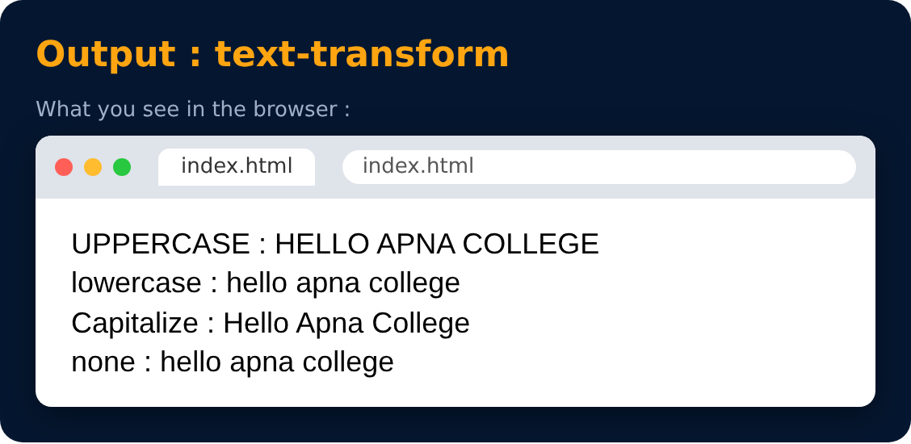

# Text Properties : text-transform

```css
text-transform : uppercase / lowercase / capitalize / none
```



---
[← Text Properties : line-height](23-text-properties-line-height.md) · [Level 1](README.md) · [Home](../README.md) · [Text Properties : more →](25-text-properties-more.md)
