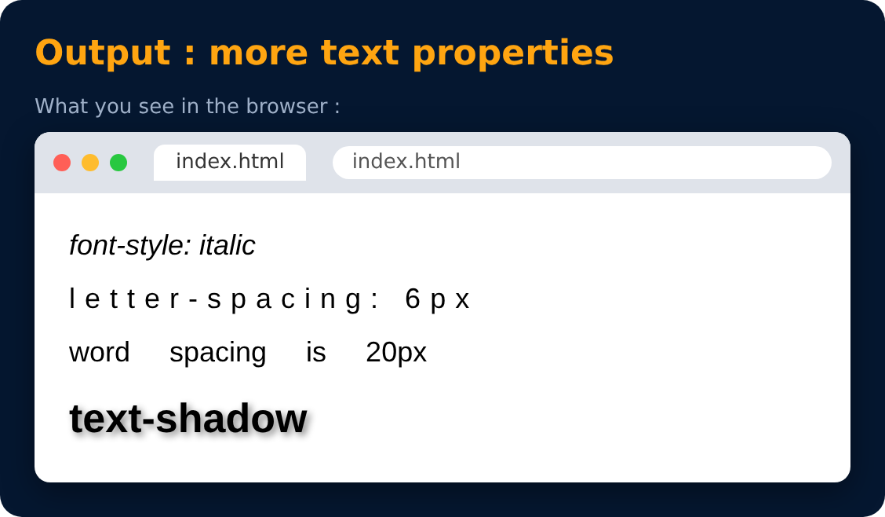

# Text Properties : more

<sub>Level 1 · Slide 25</sub>

```css
font-size : 20px / 2em / 1.5rem;
font-style : normal / italic;
letter-spacing : 2px;
word-spacing : 5px;
text-shadow : 2px 2px 5px gray;
```

`text-shadow : x-offset | y-offset | blur | color`



---
[← Text Properties : text-transform](24-text-properties-text-transform.md) · [Level 1](README.md) · [Home](../README.md) · [Practice Set 2 🚀 →](26-practice-set-2.md)
