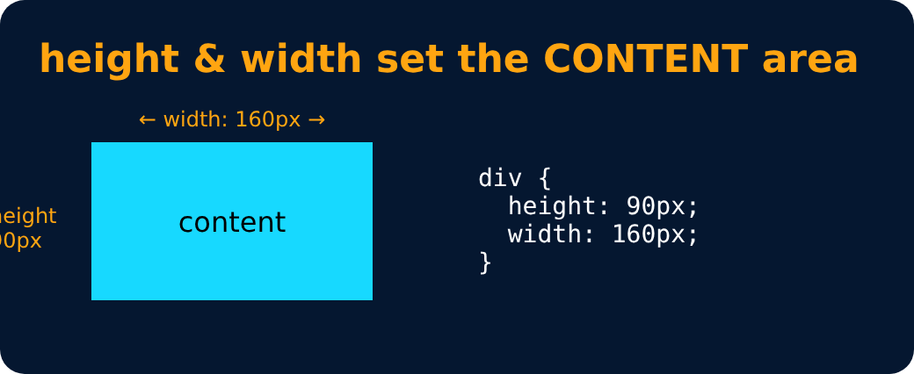

# Height

<sub>Level 2 · Slide 29</sub>

By default, it sets the content area **height** of the element

```css
div {
    height: 50px;
}
```



---
[← Box Model in CSS](28-box-model-in-css.md) · [Level 2](README.md) · [Home](../README.md) · [Width →](30-width.md)
