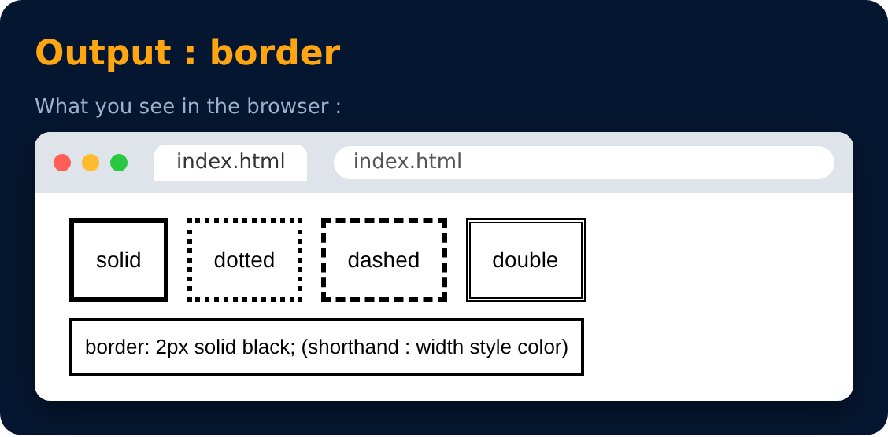

# Border

Used to set an element's **border**

```css
border-width : 2px;
border-style : solid / dotted / dashed;
border-color : black;
```



---
[← Width](30-width.md) · [Level 2](README.md) · [Home](../README.md) · [Border : Shorthand →](32-border-shorthand.md)
