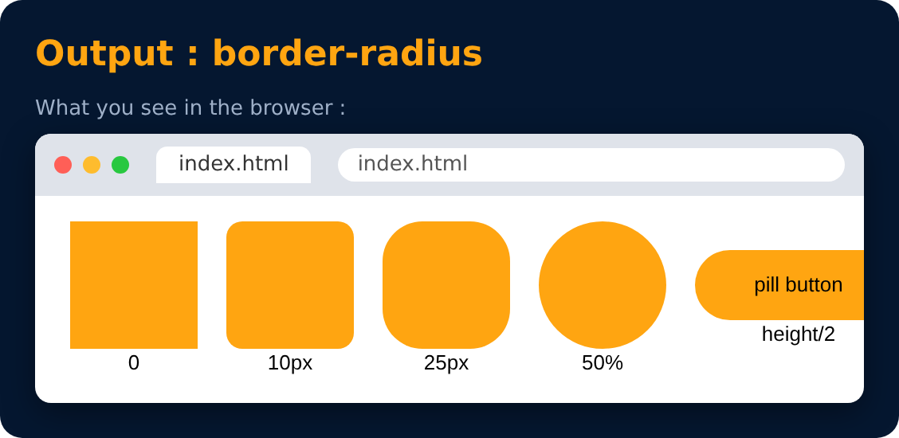

# Border : border-radius

<sub>Level 2 · Slide 33</sub>

Used to **round the corners** of an element's outer border edge

```css
border-radius : 10px;
border-radius : 50%;
```



---
[← Border : Shorthand](32-border-shorthand.md) · [Level 2](README.md) · [Home](../README.md) · [Padding →](34-padding.md)
