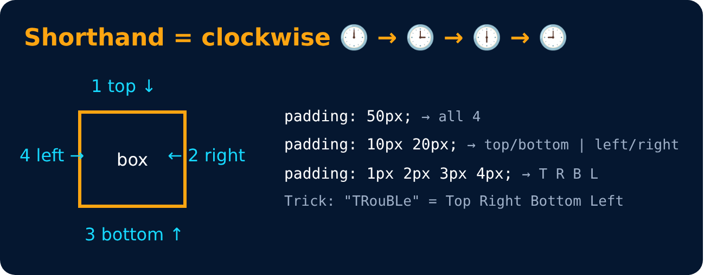

# Margin : Shorthand

<sub>Level 2 · Slide 37</sub>

```css
margin: 50px;
margin: 1px 2px 3px 4px;
```

`top | right | bottom | left` → clockwise



---
[← Margin](36-margin.md) · [Level 2](README.md) · [Home](../README.md) · [Box Sizing →](38-box-sizing.md)
