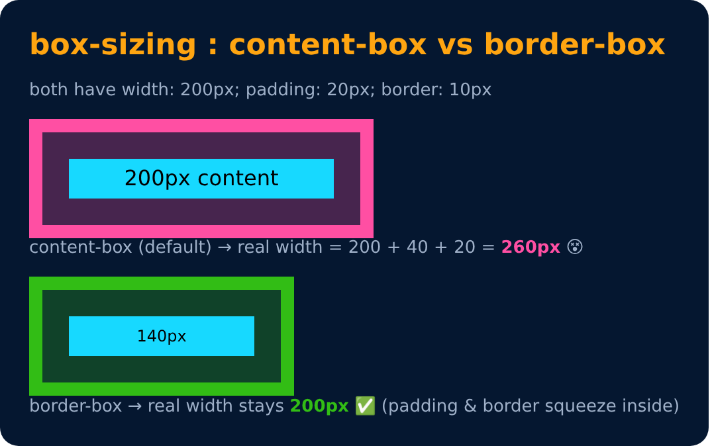

# Box Sizing

Decides if width & height include padding and border

```css
box-sizing : content-box;   /* (default) */
box-sizing : border-box;
```

- **content-box** - padding & border are added on top of the width
- **border-box** - width stays fixed, padding & border fit inside it
- Common trick : `* { box-sizing : border-box; }`



---
[← Margin : Shorthand](37-margin-shorthand.md) · [Level 2](README.md) · [Home](../README.md) · [Overflow →](39-overflow.md)
