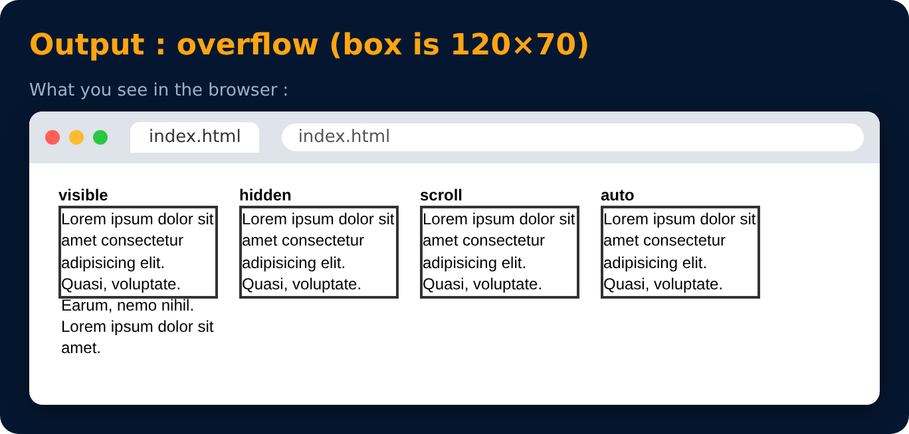

# Overflow

What happens when content is bigger than its box

```css
overflow : visible / hidden / scroll / auto;
```

- **visible** - content spills outside (default)
- **hidden** - extra content is cut off
- **scroll** - always shows scrollbars
- **auto** - shows scrollbars only when needed



---
[← Box Sizing](38-box-sizing.md) · [Level 2](README.md) · [Home](../README.md) · [Min & Max Width →](40-min-and-max-width.md)
