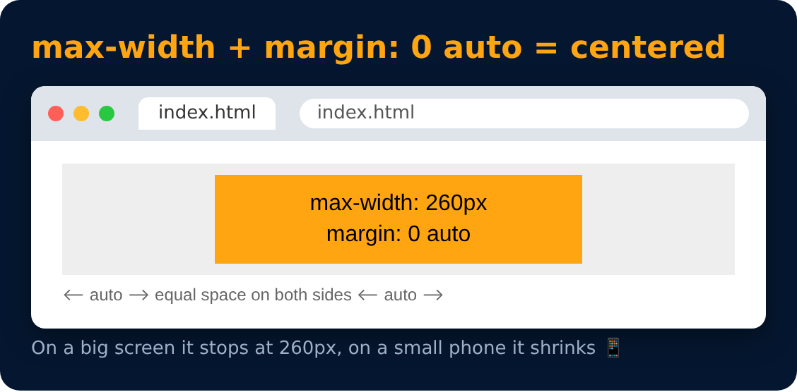

# Min & Max Width

<sub>Level 2 · Slide 40</sub>

Limit how small or big an element can get

```css
max-width : 800px;
min-width : 200px;
max-height : 400px;
min-height : 100px;
margin : 0 auto;
```

> **Note :** `max-width` + `margin : 0 auto` centers a block element on the page.



---
[← Overflow](39-overflow.md) · [Level 2](README.md) · [Home](../README.md) · [Practice Set 3 🚀 →](41-practice-set-3.md)
