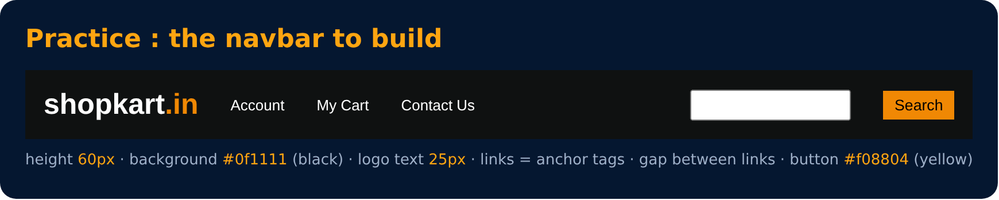

# Practice Set 3 🚀

<sub>Level 2 · Slide 41</sub>

**Q1:** Create a div with height & width of 100px. Set its background color to green & the border radius to 50%.

**Q2:** Create the following navbar.



| Part | Value |
|---|---|
| navbar height | 60px |
| background | `#0f1111` (black) |
| logo text | 25px |
| links | anchor tags |
| gap between links | 200px in the original design |
| button | `#f08804` (yellow) |

<details><summary>💡 Solution</summary>

```html
<div class="circle"></div>

<nav class="navbar">
  <span class="logo">shopkart.in</span>
  <a href="#">Account</a>
  <a href="#">My Cart</a>
  <a href="#">Contact Us</a>
  <input type="text">
  <button>Search</button>
</nav>
```

```css
.circle { height: 100px; width: 100px; background-color: green; border-radius: 50%; }

.navbar { height: 60px; background-color: #0f1111; color: white; }
.logo   { font-size: 25px; }
.navbar a { color: white; text-decoration: none; margin-left: 50px; }
button  { background-color: #f08804; border: none; }
```

(Using display: flex on .navbar makes the alignment much easier. You'll learn it in Level 4.)

</details>

---
[← Min & Max Width](40-min-and-max-width.md) · [Level 2](README.md) · [Home](../README.md) · [Display Property →](43-display-property.md)
