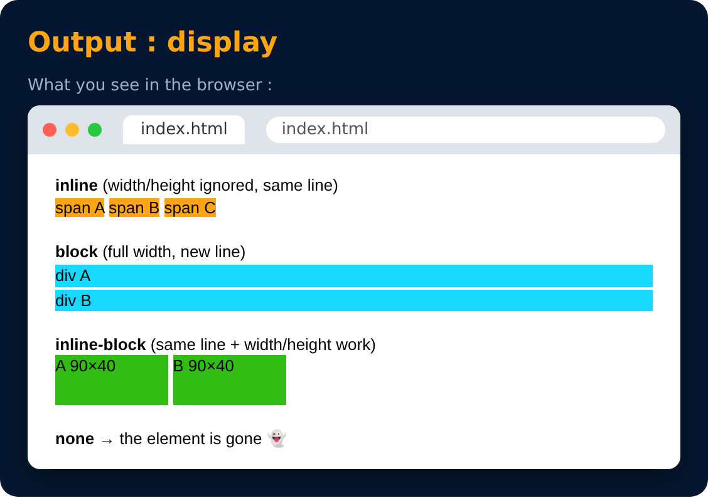

# Display Property

<sub>Level 2 · Slide 43</sub>

```css
display: inline / block / inline-block / none
```

- **inline** - Takes only the space required by the element. (width & height don't work)
- **block** - Takes full space available in width.
- **inline-block** - Similar to inline but we can set width, height, margin & padding.
- **none** - To remove element from document flow.



---
[← Practice Set 3 🚀](41-practice-set-3.md) · [Level 2](README.md) · [Home](../README.md) · [Visibility →](44-visibility.md)
