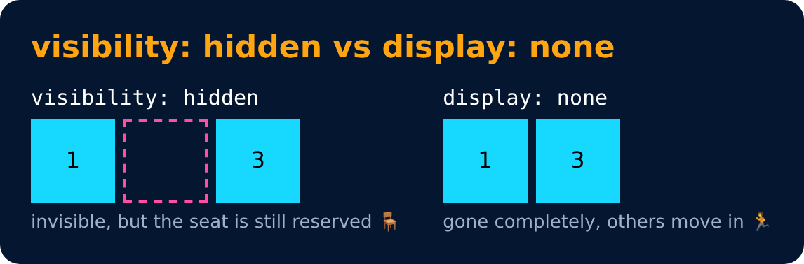

# Visibility

<sub>Level 2 · Slide 44</sub>

```css
visibility: hidden;
```

> **Note :** When visibility is set to hidden, space for the element is reserved.
> But for display set to none, no space is reserved or blocked for the element.



---
[← Display Property](43-display-property.md) · [Level 2](README.md) · [Home](../README.md) · [Alpha Channel →](45-alpha-channel.md)
