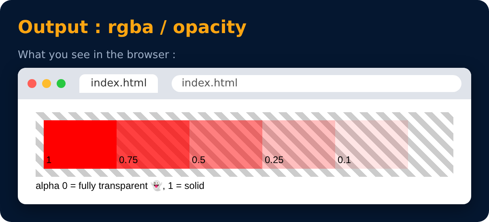

# Alpha Channel

**Alpha channel** = how **transparent** a color is. It is a number from **0 to 1**:

- `0` → fully transparent (invisible)
- `0.5` → half see-through
- `1` → fully solid (normal)

**opacity** (0 to 1)

**RGBA** = RGB + **A**lpha (the 4th value)

```css
color: rgba(255, 0, 0, 0.5);
color: rgba(255, 0, 0, 1);
```



> `opacity: 0.5` fades the **whole element** (text too). `rgba(...)` fades **only that color**.

---
[← Visibility](44-visibility.md) · [Level 2](README.md) · [Home](../README.md) · [Practice Set 4 🚀 →](46-practice-set-4.md)
