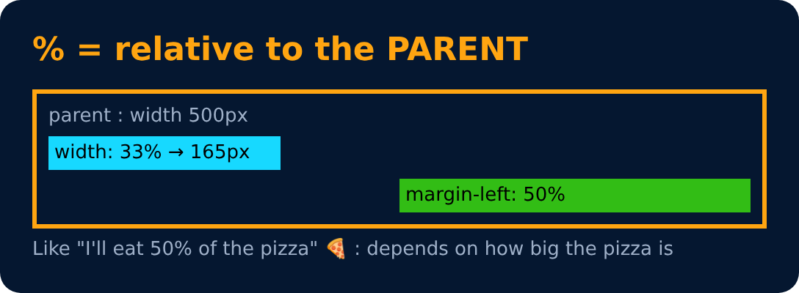

# Percentage (%)

`%` = a part of the **parent's** size.

```css
width : 33% ;        /* 1/3 of parent's width */
margin-left : 50% ;  /* half of parent's width */
```

> Parent is 600px wide → `width: 50%` = 300px.



---
[← Units in CSS : Relative](48-units-in-css-relative.md) · [Level 3](README.md) · [Home](../README.md) · [Em →](50-em.md)
