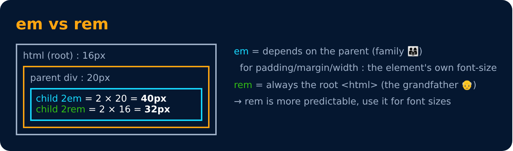

# Em

Level 3 · Slide 50

| Unit | Relative to |
|---|---|
| `em` | Font size of the parent, in the case of typographical properties like `font-size`, and font size of the element itself, in the case of other properties like `width`. |

---
[← Percentage (%)](49-percentage-percent.md) · [Level 3](README.md) · [Home](../README.md) · [Rem (Root Em) →](51-rem-root-em.md)
