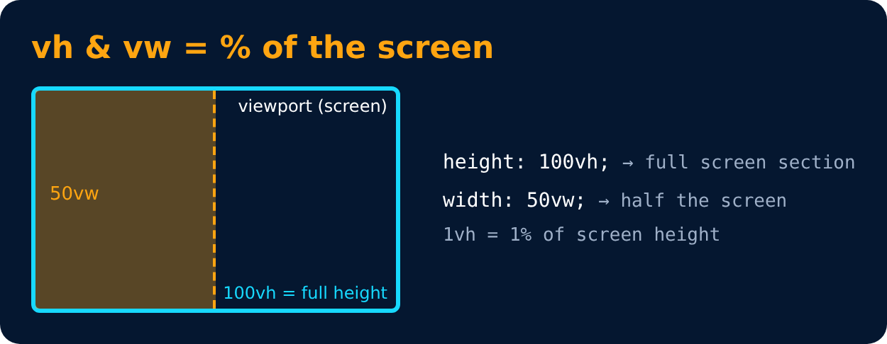

# Others

Level 3 · Slide 52

**vh** : relative to 1% viewport height

**vw** : relative to 1% viewport width

---
[← Rem (Root Em)](51-rem-root-em.md) · [Level 3](README.md) · [Home](../README.md) · [Position →](53-position.md)
