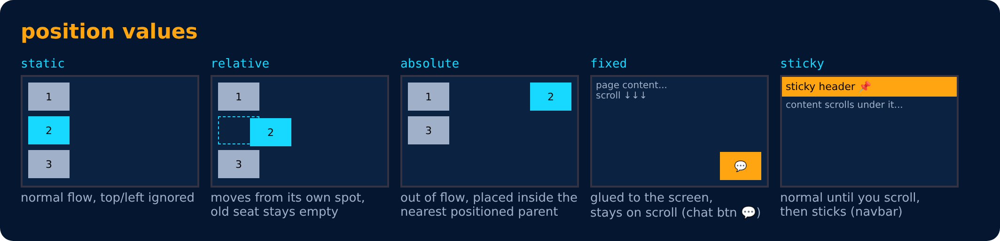

# Position : values

- **static** → default. Normal place. `top`/`left`/`z-index` do **nothing**.
- **relative** → moves from **its own normal place**. Its space stays.
- **absolute** → moves inside the **nearest parent that has a position** (not static). Removed from the flow (others fill its space).
- **fixed** → stuck to the **browser screen**. Does not move on scroll. Removed from flow.
- **sticky** → normal until you scroll to it, then **sticks** (like a sticky header).

---
[← Position](53-position.md) · [Level 3](README.md) · [Home](../README.md) · [z-index →](55-z-index.md)
