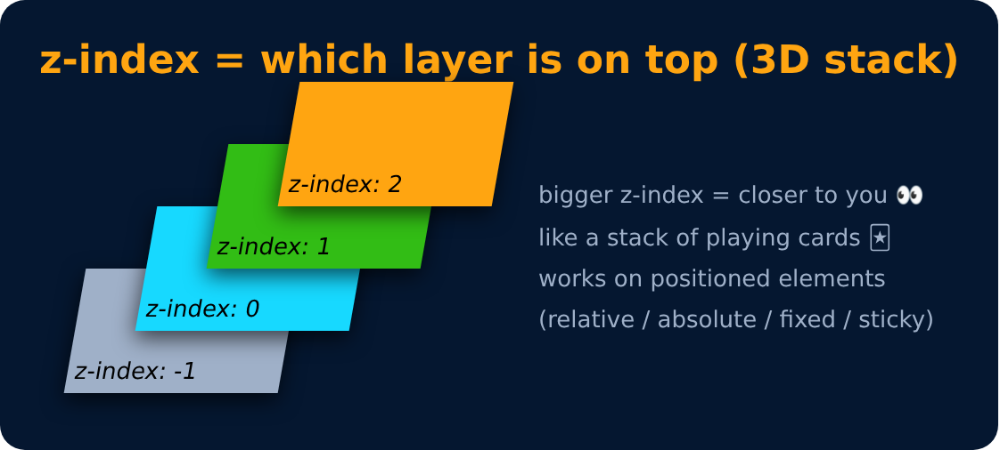

# z-index

When elements **overlap**, `z-index` decides **which one is on top**.

**Bigger number = on top.**

```css
z-index : auto (0)
z-index : 1 / 2 / ...    /* comes forward */
z-index : -1 / -2 / ...  /* goes behind */
```

> Works only on positioned elements (not `static`).



---
[← Position : values](54-position-values.md) · [Level 3](README.md) · [Home](../README.md) · [Background Image →](56-background-image.md)
