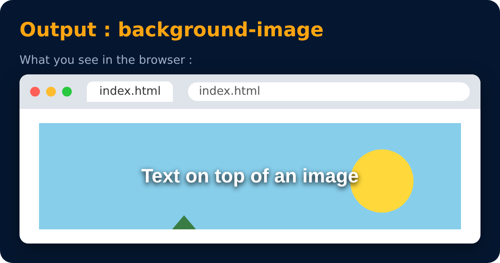

# Background Image

<sub>Level 3 · Slide 56</sub>

Used to set an image as background

```css
background-image : url("image.jpeg");
```



---
[← z-index](55-z-index.md) · [Level 3](README.md) · [Home](../README.md) · [Background Size →](57-background-size.md)
