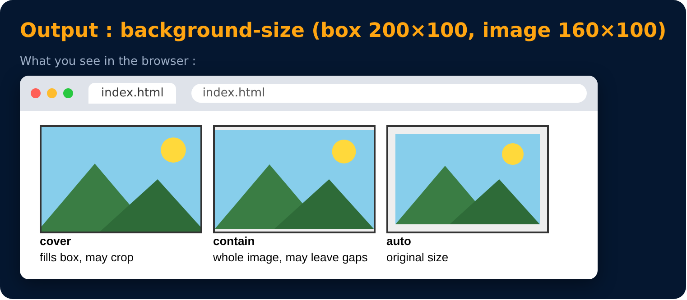

# Background Size

<sub>Level 3 · Slide 57</sub>

```css
background-size : cover / contain / auto
```

- **cover** = fits with no empty space
- **contain** = fits with image fully visible
- **auto** = original size



---
[← Background Image](56-background-image.md) · [Level 3](README.md) · [Home](../README.md) · [Background : more →](58-background-more.md)
