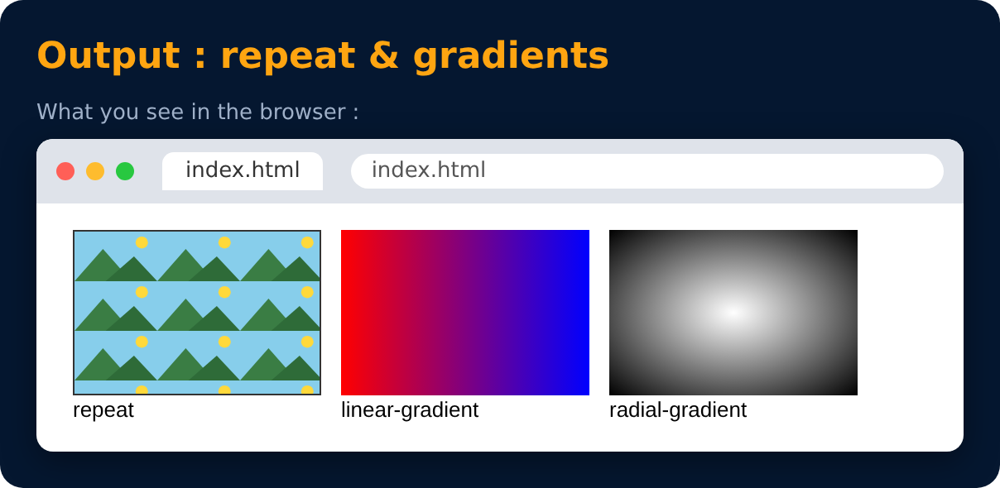

# Background : more

```css
background-repeat : repeat / no-repeat / repeat-x / repeat-y;
background-position : center / top / left / 50% 50%;
background : linear-gradient(to right, red, blue);
background : radial-gradient(white, black);
```

- **repeat** → should the image repeat (tile)? `repeat-x` = only sideways, `repeat-y` = only up-down
- **position** → where the image sits in the box
- **gradient** → smooth blend of colors
  - **linear** → in a straight line (left → right)
  - **radial** → from the center outwards (circle)



---
[← Background Size](57-background-size.md) · [Level 3](README.md) · [Home](../README.md) · [Shadows →](59-shadows.md)
