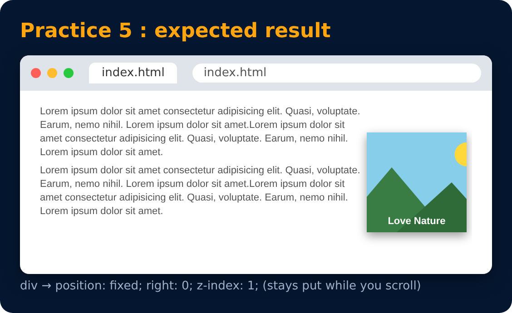

# Practice Set 5 🚀

<sub>Level 3 · Slide 60</sub>

**Qs:** Create the following layout using the given html.
- Give the div a height, width & some background image.
- Use the appropriate position property for the div element to place it at the right end of the page. (The div should not move even on scroll)
- Use z-index to place the div on top of page.

```html
<p> lorem*5 </p>
<div> Love Nature </div>
<p> lorem*5 </p>
```




<details><summary>💡 Solution</summary>

```css
div {
  height: 200px;
  width: 200px;
  background-image: url("nature.jpg");
  background-size: cover;
  position: fixed;     /* stays on scroll */
  right: 0;
  top: 100px;
  z-index: 1;          /* on top of the paragraphs */
}
```

</details>

---
[← Shadows](59-shadows.md) · [Level 3](README.md) · [Home](../README.md) · [Flexbox →](../level-4/62-flexbox.md)
