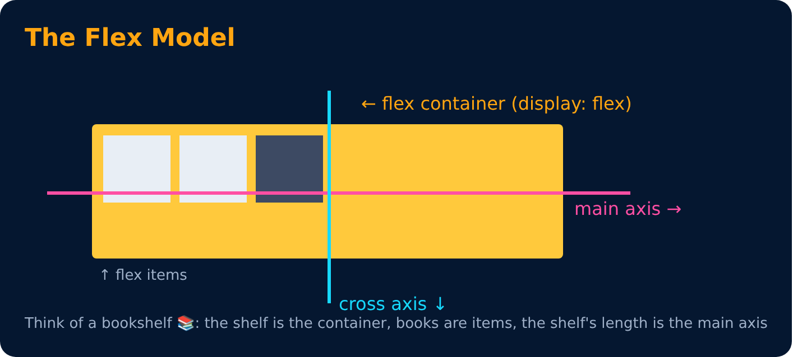

# The Flex Model

<sub>Level 4 · Slide 63</sub>

- flex container
- flex item
- main axis
- cross axis

> Set the `display` property of the container to `flex` first.

```css
.container { display: flex; }
```



---
[← Flexbox](62-flexbox.md) · [Level 4](README.md) · [Home](../README.md) · [Flexbox Direction →](64-flexbox-direction.md)
