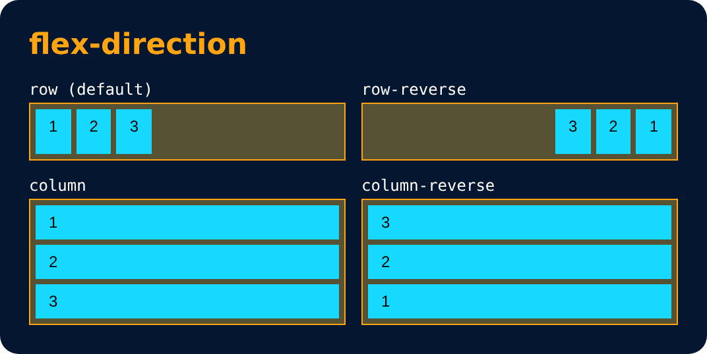

# Flexbox Direction

<sub>Level 4 · Slide 64</sub>

It sets how flex items are placed in the flex container, along which axis and direction.

```css
flex-direction : row;            /* (default) */
flex-direction : row-reverse;
flex-direction : column;
flex-direction : column-reverse;
```



> ⚠️ With `column`, the main axis becomes vertical, so `justify-content` works up-down and `align-items` works left-right.

---
[← The Flex Model](63-the-flex-model.md) · [Level 4](README.md) · [Home](../README.md) · [Flex Properties : for Flex Container →](65-flex-properties-for-flex-container.md)
