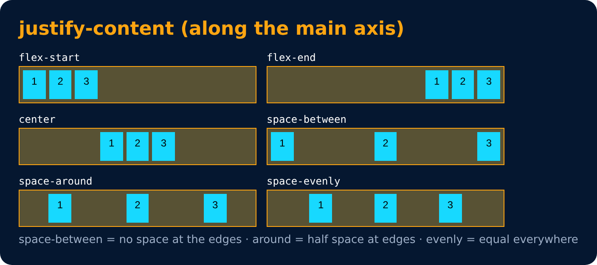
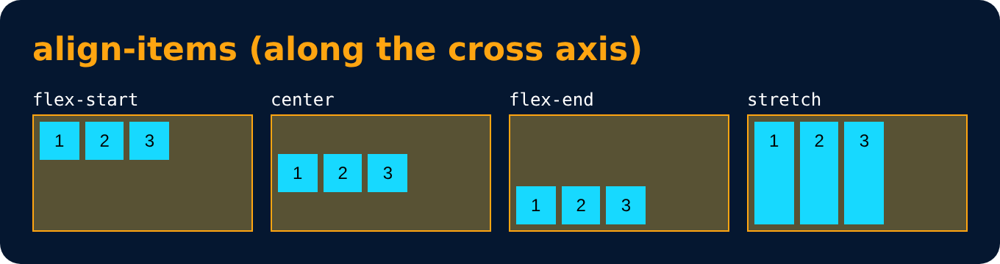
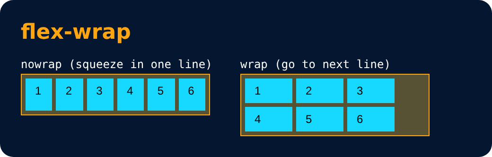

# Flex Properties : for Flex Container

- **justify-content** : alignment along the main axis.
  `flex-start / flex-end / center / space-between / space-around / space-evenly`
- **flex-wrap** : `nowrap / wrap / wrap-reverse`
- **align-items** : alignment along the cross axis.
- **align-content** : alignment of space between & around the content along cross-axis

---
[← Flexbox Direction](64-flexbox-direction.md) · [Level 4](README.md) · [Home](../README.md) · [Flex Properties : for Flex Item →](66-flex-properties-for-flex-item.md)
