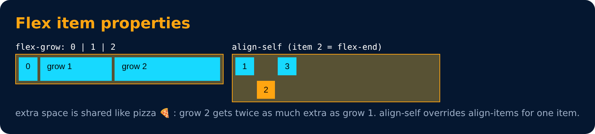

# Flex Properties : for Flex Item

- **align-self** : alignment of individual along the cross axis. (similar to align-items but for one element, and it overrides align-items)
- **flex-grow** : how much a flex item will grow relative to the rest of the flex items if space is available
- **flex-shrink** : how much a flex item will shrink relative to the rest of the flex items if space is not enough
- **flex-basis** : starting size of a flex item before it grows or shrinks

> grow & shrink take values like 0, 1, 2, 3. 0 = doesn't grow at all.

---
[← Flex Properties : for Flex Container](65-flex-properties-for-flex-container.md) · [Level 4](README.md) · [Home](../README.md) · [Flex Properties : Shorthand & spacing →](67-flex-properties-shorthand-and-spacing.md)
