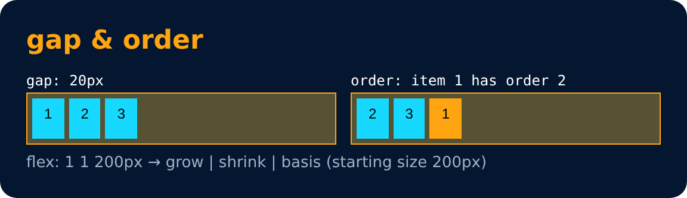

# Flex Properties : Shorthand & spacing

<sub>Level 4 · Slide 67</sub>

```css
flex : 1;
flex : 1 1 200px;   /* grow | shrink | basis */
gap : 20px;
order : 2;
```

- **gap** - space between flex items (set on the container)
- **order** - changes the position of an item (default 0)



---
[← Flex Properties : for Flex Item](66-flex-properties-for-flex-item.md) · [Level 4](README.md) · [Home](../README.md) · [CSS Grid →](68-css-grid.md)
