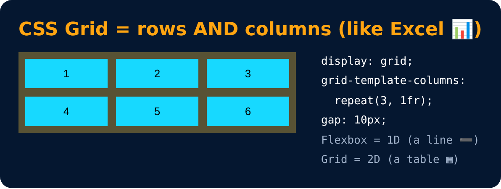

# CSS Grid

A **two-dimensional** layout method (rows & columns together)

```css
display : grid;
grid-template-columns : 1fr 1fr 1fr;
grid-template-columns : repeat(3, 1fr);
grid-template-rows : 100px 200px;
gap : 10px;
```

**fr** = one fraction of the free space. **Flexbox = 1D, Grid = 2D**



---
[← Flex Properties : Shorthand & spacing](67-flex-properties-shorthand-and-spacing.md) · [Level 4](README.md) · [Home](../README.md) · [Grid Item →](69-grid-item.md)
