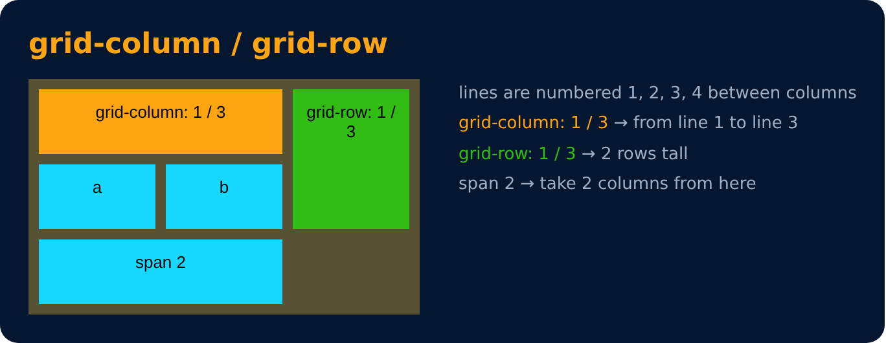

# Grid Item

Make an item span multiple columns or rows

```css
grid-column : 1 / 3;
grid-row : 1 / 3;
grid-column : span 2;
```

- `1 / 3` = start at line 1, end at line 3 (covers 2 columns)
- `span 2` = take 2 columns from where it is
- `justify-items` / `align-items` work in grid too



---
[← CSS Grid](68-css-grid.md) · [Level 4](README.md) · [Home](../README.md) · [Practice Set 6 🚀 →](70-practice-set-6.md)
